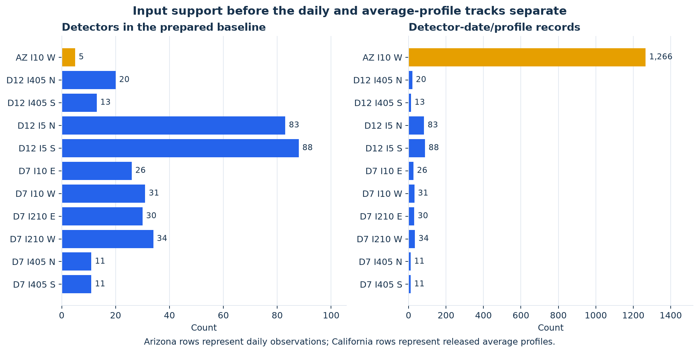

# 1. Inputs and fixed settings

Start here to distinguish the supplied observations from the preserved preprocessing results. These tables describe the experiment that produced the current results; they do not select a new sample.

| Open | What it contains |
|---|---|
| [01_source_inventory.csv](01_source_inventory.csv) | Source path, role, dimensions, size and SHA-256 for the original four traffic files, prepared baseline and frozen track inputs/results. |
| [02_baseline_support_by_corridor.csv](02_baseline_support_by_corridor.csv) | Detector, date, profile and five-minute-record counts before the daily and average-weekday analyses separate. |
| [03_calculation_constants.csv](03_calculation_constants.csv) | Time step, support rules, jam density, fitting limits, period definitions, outlier rules and uncertainty settings. |

## Inputs → preparation → outputs

**Arizona:** the supplied lane-speed and lane-count files feed the preserved detector-level baseline. For an interval with all declared mainline lanes present, the baseline uses per-lane flow and count-weighted harmonic speed. With lane count $n_\ell$, speed $v_\ell$, number of lanes $J$ and $\Delta t=1/12$ h:

$$q=\frac{\sum_\ell n_\ell}{J\Delta t},\qquad v=\frac{\sum_\ell n_\ell}{\sum_\ell n_\ell/v_\ell}.$$

An absent lane is missing information, not zero traffic. The retained Arizona baseline uses five selected detectors. Detector 78's separately supplied worked example is documented in the other debug guide; it is not an extra episode in this cohort.

**California:** the supplied PeMS records are released average-weekday profiles and link metadata. They are not independent daily observations.

The exact traffic source files and prepared observations are in [data/inputs/empirical](../../../../data/inputs/empirical/). Emission-rate tables are in [data/frozen/calibration/emission_input](../../../../data/frozen/calibration/emission_input/), and their rate calculations are described in the later emission step.

## What is and is not reproduced here

The inventory is freshly calculated from the included files. The four original file hashes are checked against the preserved manifest. The numerical experiment starts from the preserved preprocessing baseline. This trace does **not** rerun the earlier raw-lane-to-baseline construction or infer undocumented detector-selection choices from the raw files. The baseline itself is supplied, so all subsequent calculations have a fixed input.

Quantities $q$, $C$, $D$ and vehicle-hours in these steps are **per lane**. Speeds are mph; link lengths are miles; time is hours. “D/C” means episode volume divided by hourly capacity and therefore has units of **hours**. It is not a rolling-hour flow/capacity ratio.

Next: [2. Prepared profiles](../02_prepared_profiles/README.md).

## Diagnostic figure

[Editable SVG](diagnostic.svg). Both panels plot `02_baseline_support_by_corridor.csv`: detector count and detector-date/profile count. They show available support, not goodness of fit. The Arizona bar contains daily records, while California bars contain released average profiles; the counts are deliberately labeled separately from the later average-profile cohort.
