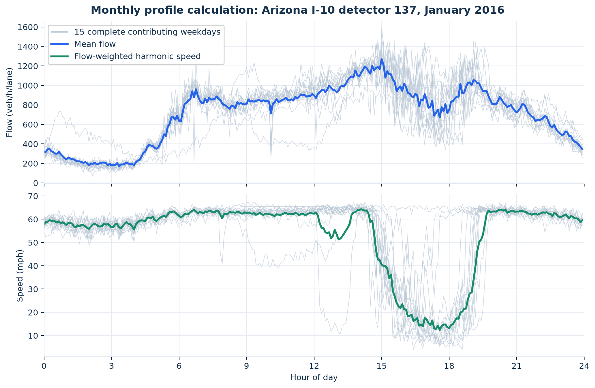

# 2. Prepared profiles and separate validation tracks

The emission experiment uses independently calibrated average-weekday profiles. Daily Arizona observations form a separate chronological traffic-validation experiment. They are not pooled with the average profiles for the 137-episode emission comparison.

| Open | Calculation or result |
|---|---|
| [01_profile_support_ledger.csv](01_profile_support_ledger.csv) | One detector-date/profile per row: valid-bin count, flow total, vehicle-hours, date-filter status and detected-episode count. |
| [02_average_profile_detection_inputs.csv.gz](02_average_profile_detection_inputs.csv.gz) | Every average-profile five-minute input, reconstructed smoothed speed, thresholds, QC flag and calendar-filter status. Compressed CSV; expand before opening in a spreadsheet. |
| [03_arizona_day_support.csv](03_arizona_day_support.csv) | Frozen daily support ledger: completeness and whether each day contributed to its monthly profile. |
| [04_arizona_month_support.csv](04_arizona_month_support.csv) | Frozen number of complete weekdays and inclusion decision for every Arizona detector-month. |
| [05_arizona_monthly_bin_calculations.csv](05_arizona_monthly_bin_calculations.csv) | The 14,400 monthly-profile bins: sums, day counts, mean flow, harmonic speed, volume, vehicle-hours and differences from the frozen values. |
| [06_daily_validation_date_split.csv](06_daily_validation_date_split.csv) | All dates in the separate daily track, with training/test designation and record support. |

## Monthly average construction

A complete contributing day has 288 distinct five-minute bins, finite $q\ge0$, and finite $0<v\le90$ mph in every bin. A detector-month must have at least five complete weekdays. At each clock-time bin, let $d=1,\ldots,N$ index those days:

$$\bar q=\frac1N\sum_dq_d,\qquad \overline{q/v}=\frac1N\sum_d\frac{q_d}{v_d},\qquad
\bar v=\frac{\bar q}{\overline{q/v}}.$$

This preserves the mean vehicle-hours:

$$\bar q\Delta t\frac{L}{\bar v}=\frac1N\sum_dq_d\Delta t\frac{L}{v_d}.$$

If mean flow is zero, the stored policy uses arithmetic mean speed; no Arizona monthly bin required that fallback. The prepared files contain 50 Arizona monthly profiles and 347 released California profiles. The support ledger shows which artificial profile dates pass the inherited weekday calendar filter. All frozen episode boundaries and result masks are preserved.

## Smoothing used for detection

Raw five-minute speed is retained. Detection uses a **five-bin, quadratic Savitzky–Golay** smooth, with interpolated edge treatment. The implementation temporarily interpolates missing values to evaluate the smooth, then restores missingness at every originally missing position. Thus the table contains both recorded speed and smoothed detection speed; the speed used for travel-time and emission calculations remains the recorded value.

The main congestion threshold is $0.70v_f$ and the free-state threshold is $0.85v_f$. The full effective settings, including 30-minute minimum episodes and 15-minute merging gap, appear in [step 3's configuration table](../03_episode_detection/05_detection_configuration.csv). Reconstructed smoothing is an explanatory intermediate, not a new detection run.

## Daily training and testing

The separate daily track has 206 training dates through **2016-10-19** and 52 later dates from **2016-10-20**. Detector FD estimates and QVDF parameters use training observations. The average-weekday Arizona FD and QVDF fits are independent profile fits; California is also a profile fit. Average-profile fit metrics are in-sample results, not holdout scores.

For the profile-support vehicle-hours column, only valid bins contribute; `VHT_valid_bin_count` indicates its support. A partial profile's partial sum must not be interpreted as a complete day's vehicle-hours.

Source equations: [data preparation](../../../../src/qvdfe/pipeline/_engine/data_preparation.py) and [detection smoothing](../../../../src/qvdfe/pipeline/_engine/cbi_state_transition.py). Freshly recomputed monthly values are reconciled to frozen data in [step 4](../04_calibration/06_trace_reconciliation.csv).

Next: [3. Episode targets and screening](../03_episode_detection/README.md).

## Diagnostic figure

[Editable SVG](diagnostic.svg). The example is Arizona detector 137 in January 2016. Gray curves are the 15 contributing daily profiles selected by `03_arizona_day_support.csv`, read from the canonical daily panel. Blue mean flow and green harmonic speed come from `05_arizona_monthly_bin_calculations.csv`. This shows how averaging reduces day-to-day variation while preserving mean vehicle-hours; it is not a forecast-validation plot. The full reconstructed detection-speed series for every average profile is in the compressed calculation table above.
