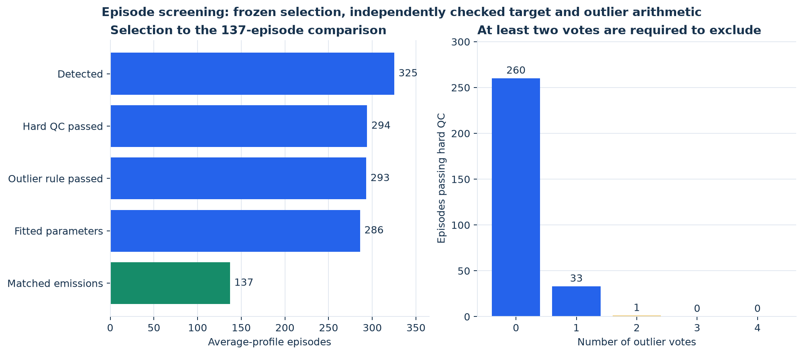

# 3. Whole episodes, observed targets and screening

The recorded average-profile experiment has **325 detected episodes**, not 137 initially detected episodes. The 137 are the final matched emission-comparison subset. The separate daily-validation track has 1,477 detected episodes.

| Open | Calculation or result |
|---|---|
| [01_observed_target_calculations.csv](01_observed_target_calculations.csv) | For all 1,802 average/daily episodes: interval count, flow sum, volume, D/C, discharge, vehicle-hours, mean/peak delay and shape ratio; calculated and frozen targets side by side. |
| [02_episode_screening_ledger.csv](02_episode_screening_ledger.csv) | Every episode's boundaries, sample track, QC flags, four outlier votes, fit availability and first exclusion stage. |
| [03_outlier_fit_thresholds.csv](03_outlier_fit_thresholds.csv) | Corridor-direction robust-log-line coefficients, median residuals, MAD scales and actual rejection thresholds. |
| [04_outlier_residual_calculations.csv](04_outlier_residual_calculations.csv) | Four rows per episode: residual, robust z-score, recalculated vote and frozen vote. |
| [05_detection_configuration.csv](05_detection_configuration.csv) | Effective detection constants, including smoothing, congestion thresholds, recovery and gap settings. |
| [06_sample_flow_counts.csv](06_sample_flow_counts.csv) | Sample counts at each stage, overall and by corridor direction, with the daily track kept separate. |

## Whole-episode targets

The saved interval is $[t_0,t_3)$, including every five-minute reading before the exclusive end boundary. The whole episode is assigned to the period containing the minimum-speed time $t_2$; it is **not split at period boundaries**. For bin $i$:

$$n_i=q_i\Delta t,\quad P=t_3-t_0,\quad D=\sum_i n_i,\quad x=D/C,\quad \mu_{obs}=D/P,\quad T_f=L/v_f.$$

$$w_i=L/v_i-T_f,\quad w_{max}=L/\min_i(v_i)-T_f,\quad
\bar w=\frac{\sum_i n_iw_i}{D},\quad \theta_{obs}=\bar w/w_{max}.$$

The observed total vehicle-hours are $\sum_i n_iL/v_i$. `mu_obs_vphpl` in the source episode file is a separate recovery-window diagnostic used by one outlier relationship; `mu_vphpl` and this trace's `mu_calculated_vphpl` are the whole-episode $D/P$. They must not be interchanged.

## Hard QC, then outlier votes

Hard QC requires complete intervals, valid speed/flow, positive $D$, positive peak delay and $0<\theta_{obs}<1$. Calendar-day-censored episodes and invalid capacity metadata also fail. Flagged raw speeds are retained; the episode validity requirements are applied separately. `qc_reason` in the frozen file does not enumerate the nonpositive-delay and shape-ratio checks, so inspect the calculated targets alongside its flags.

Outliers use the same corridor direction's hard-QC-passing training episodes. At least eight are required. The four possible votes are:

1. Log-duration versus log-$D/C$.
2. Log-normalized peak delay $\log(w_{max}/T_f)$ versus log-duration.
3. Log-recovery-window discharge versus log-$D/C$.
4. Marginal log-duration distance from its median.

For each relation, $r=\log y-(b_0+b_1\log x)$ and

$$z=\frac{|r-\operatorname{median}(r)|}{\max(1.4826\operatorname{MAD}(r),0.10)}.$$

Marginal duration uses $r=\log P$ and a 0.20 scale floor. A vote requires $z>3.5$; **at least two votes** exclude an episode. A long duration alone supplies only one vote. The tables expose the exact thresholds and residuals rather than applying an arbitrary new maximum duration.

## From 325 to 137

| Stage | Episodes remaining | Meaning |
|---|---:|---|
| Detected average-profile episodes | 325 | Frozen whole-episode inventory |
| Pass hard QC | 294 | 31 excluded |
| Pass outlier rule | 293 | 1 additional exclusion |
| Have fitted parameters | 286 | 7 eligible D12 I-405 south episodes have insufficient fitting support |
| Pass predicted finite-link geometry | 137 | 149 fitted episodes exceed model admissibility |
| Matched, closed emission comparison | 137 | Final common comparison cohort |

The observed geometric check passes 104 eligible episodes, but **is diagnostic, not the emission admission mask**. Traffic-calibration scores use eligible finite observed/predicted pairs (286 for the principal average-profile targets), before the final emission restriction. Daily traffic validation likewise keeps eligible finite pairs rather than using its geometric subset; it has no episode-emission comparison in this experiment.

Boundaries, flags and masks in the screening ledger are frozen results. Observed target arithmetic and outlier residuals/votes are freshly recomputed and checked against them. Source: [model targets](../../../../src/qvdfe/pipeline/_engine/model.py), [normalized outlier screening](../../../../src/qvdfe/pipeline/_engine/calibration.py), and [episode boundary/period logic](../../../../src/qvdfe/pipeline/_engine/episodes.py).

Next: [4. Calibration and predicted quantities](../04_calibration/README.md).

## Diagnostic figure

[Editable SVG](diagnostic.svg). The left panel uses the average-track counts in `06_sample_flow_counts.csv`. The right panel counts `outlier_votes` only among hard-QC-passing episodes in `02_episode_screening_ledger.csv`; two or more votes is the exclusion criterion. The figure makes the dominant reduction from fitted traffic episodes to finite-link-admissible emission episodes visible. It does not treat an excluded episode as invalid observed traffic.
