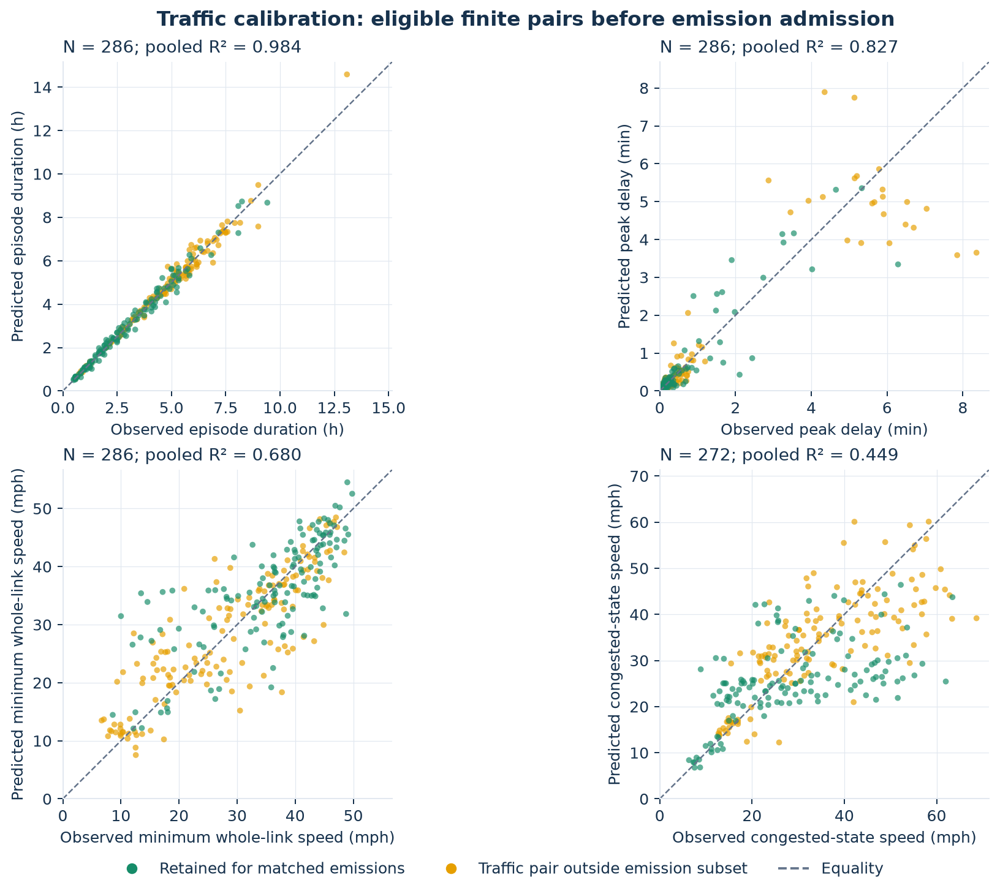

# 4. Calibration and predicted traffic quantities

This step shows how each frozen parameter card is supported and how it produces every episode prediction. It preserves the fitted values; it does not fit a new model.

| Open | Calculation or result |
|---|---|
| [01_parameter_cards_with_derived_coefficients.csv](01_parameter_cards_with_derived_coefficients.csv) | All 44 average-profile and four daily-validation cards, confidence limits, recalculated $\alpha,\beta$ and the source median giving $\theta$. |
| [02_detector_FD_inputs_and_outcomes.csv](02_detector_FD_inputs_and_outcomes.csv) | Detector length/lanes, candidate FD fit, acceptance or fallback, retained $C,v_f,k_j$ and calculated triangular-FD quantities. |
| [03_parameter_fit_episode_membership.csv](03_parameter_fit_episode_membership.csv) | Which episodes support each period card, including all-period fallback; log-transformed inputs, fitted log values and residuals. An episode may support multiple fallback cards. |
| [04_prediction_calculations_all_episodes.csv](04_prediction_calculations_all_episodes.csv) | All 1,802 detected episodes, with power duration, bounded duration, severity, delay, minimum speed, discharge, FD queue speed and finite-link limit. Missing fits remain missing. |
| [05_traffic_fit_metrics_and_intervals.csv](05_traffic_fit_metrics_and_intervals.csv) | Frozen pooled and corridor traffic scores with confidence intervals; daily training/testing are separate. |
| [06_trace_reconciliation.csv](06_trace_reconciliation.csv) | Numerical checks against frozen targets, outlier votes, card support and predictions, with explicit tolerances. |

## Detector fundamental diagram

The empirical detector fit uses the S3 relation with derived density $k=q/v$:

$$v(k)=\frac{v_f}{[1+(k/k_c)^m]^{2/m}},\qquad q(k)=kv(k),\qquad C=k_cv_f2^{-2/m}.$$

Acceptance requires sufficient data on both branches, successful fitting, no active parameter bound, $500\le C\le3500$ veh/h/lane and $40\le v_f\le90$ mph. Otherwise the preserved quantile fallback is used. [The complete protocol](../../../../data/frozen/calibration/fd_estimation_protocol.json) records the 50-pair minimum, 12-pair branch support, fit bounds and objective. S3 critical density/speed and the triangular queue-state quantities below are different quantities; both are labeled in the table.

## QVDF fit, by corridor direction and period

At least eight eligible training episodes are needed in a period. If fewer, use eligible episodes from all periods of the **same corridor direction**. If this also has fewer than eight, that card is unavailable. Fallback membership is explicit in the membership table; it does not change an episode's assigned period.

The fitted relations are

$$\widehat P=\max(f_dx^n,x),\qquad \frac{\widehat w_{max}}{T_f}=f_p\widehat P^s,\qquad
\widehat{\bar w}=\theta\widehat w_{max}.$$

Duration minimizes robust `soft_l1` residuals in log space with the lower bound $P\ge x$. Severity uses a robust log-linear slope, clipped to $0.05\le s\le6$, and a median intercept. $\theta$ is the median observed mean-to-peak delay ratio in the fit sample. On the power branch,

$$\alpha=\theta f_pf_d^s,\qquad \beta=ns,\qquad \widehat{\bar w}=T_f\alpha x^\beta.$$

## Prediction arithmetic and physical check

$$\widehat v_{min}=\frac{v_f}{1+\widehat w_{max}/T_f},\qquad
\widehat\mu=\frac D{\widehat P},\qquad
\omega=\frac C{k_j-C/v_f},\qquad
\widehat k_q=k_j-\widehat\mu/\omega,\qquad
\widehat v_q=\widehat\mu/\widehat k_q.$$

Here $\widehat v_{min}$ is predicted minimum **whole-link** speed, whereas $\widehat v_q$ is the congested **state** speed. The two-speed model requires

$$0<\widehat v_q<v_f,\qquad \widehat w_{max}\le L(1/\widehat v_q-1/v_f).$$

The prediction table gives the difference between predicted peak delay and this limit. Positive excess is why a fitted episode can fail the emission model's finite-link requirement. `physical_predicted_pass` remains the preserved result including its numerical tolerances.

## Scores and confidence intervals

$$R^2=1-\frac{\sum_j(\widehat y_j-y_j)^2}{\sum_j(y_j-\bar y)^2},\qquad
\mathrm{RMSE}=\sqrt{\frac1N\sum_j(\widehat y_j-y_j)^2},\qquad
\mathrm{WAPE}=100\frac{\sum_j|\widehat y_j-y_j|}{\sum_j|y_j|}.$$

Fits remain direction-specific. Paper corridor scores pool paired errors across directions. Minimum-speed/duration/delay scores use eligible finite pairs; the queue-state-speed score additionally requires both states to lie strictly between zero and $v_f$. These are traffic scores, not the later 137-episode emission scores.

The frozen 95% parameter intervals use 400 block-bootstrap **refits**, conditional on fixed preprocessing, detector FD, boundaries and QC. Metric intervals use 400 paired block resamples of **fixed predictions**, not full pipeline refits. Average-profile blocks are detector-profiles; daily metric blocks are calendar dates with all detectors together. These intervals are not new-episode prediction intervals. Original bootstrap draws remain in each track's `parameter_bootstrap.csv.gz` under [data/frozen/calibration](../../../../data/frozen/calibration/).

Source: [calibration](../../../../src/qvdfe/pipeline/_engine/calibration.py), [traffic/FD prediction equations](../../../../src/qvdfe/pipeline/_engine/model.py), and [FD acceptance](../../../../src/qvdfe/pipeline/_engine/detector_calibration.py).

## Diagnostic figure

[Editable SVG](diagnostic.svg). The four panels use the average-track rows of `04_prediction_calculations_all_episodes.csv`, keeping eligible finite pairs and applying the additional queue-state-speed bounds described above. Color is the frozen matched-emission flag from step 3; the dashed line is equality, not a fitted regression. The displayed $R^2$ pools all plotted pairs. The queue-state observed target is itself inferred from observed $D/P$ and the FD, not independently measured vehicle trajectories. Daily holdout scores are available in `05_traffic_fit_metrics_and_intervals.csv` and are not mixed into this figure.
