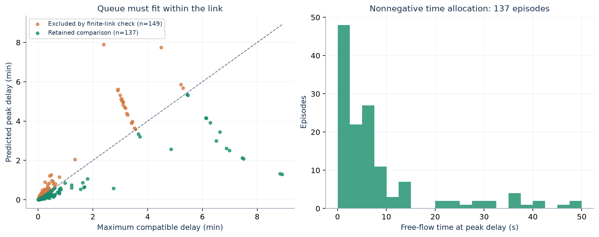

# 5. Physical admission to the emission comparison

**Input:** all 325 frozen average-profile episodes and their fitted quantities from [step 4](../04_calibration/README.md). **Output:** the unchanged 137-episode matched comparison, with every admission decision visible in [physical_admission_325.csv](physical_admission_325.csv). Join subsequent tables using `episode_id`; `corridor` retains direction, and `paper_corridor` pools directions for reporting.

## Calculations

For episode volume $D$ (veh/lane), capacity $C$ (veh/h/lane), length $L$ (mi) and free speed $v_f$ (mph):

$$x=D/C,\quad T_f=L/v_f,\quad \widehat P=\max(f_dx^n,x),\quad
\widehat w_{max}=T_ff_p\widehat P^s,\quad \widehat\mu=D/\widehat P.$$

The triangular-FD closure uses $k_j=220$ veh/mi/lane:

$$\omega=\frac C{k_j-C/v_f},\qquad \widehat k_q=k_j-\widehat\mu/\omega,\qquad
\widehat v_q=\widehat\mu/\widehat k_q.$$

At peak delay, the implied two-speed travel times are

$$t_q=\frac{v_f\widehat w_{max}}{v_f-\widehat v_q},\qquad
t_f=T_f-\frac{\widehat v_q\widehat w_{max}}{v_f-\widehat v_q}.$$

Their physical condition is $0<\widehat v_q<v_f$ and

$$\widehat w_{max}\le L(1/\widehat v_q-1/v_f).$$

`delay_margin_s` is **allowed minus predicted** delay in seconds; a negative value indicates an excess. All other time columns are hours. The model applies a $10^{-10}$ h tolerance to the delay bound and a relative $10^{-10}$ separation below $v_f$.

## Admission sequence

The matched flag requires calibration eligibility, a valid predicted finite-link state, a closed reconstructed profile, $5\le\widehat v_q<v_f\le75$ mph for the cubic rate, and finite positive emission totals for **all five methods × four pollutants = 20 totals**. The table gives each component, rather than removing failed rows.

Of the 286 eligible episodes with fitted parameters, 149 fail predicted geometry and 137 remain. All 137 also pass profile closure, cubic domain and the positive-total condition. `physical_observed_pass` is an independent diagnostic; it is **not** an additional selection condition. The 137 are derived from fitted average profiles, not a new out-of-sample validation set.

## Diagnostic figure

[Editable SVG](diagnostic_physical_admission.svg). Both panels use `physical_admission_325.csv`. Left: predicted peak delay versus its link-compatible maximum, restricted to eligible fitted episodes; the dashed line is equality. Right: the implied free-flow travel time at peak delay for the 137 retained episodes. This tests internal time/distance feasibility; it does not establish that the inferred physical queue is an observed vehicle trajectory.

Source: [traffic and admission equations](../../../../src/qvdfe/pipeline/_engine/model.py). Next: [6. Rate construction](../06_rate_construction/README.md).
