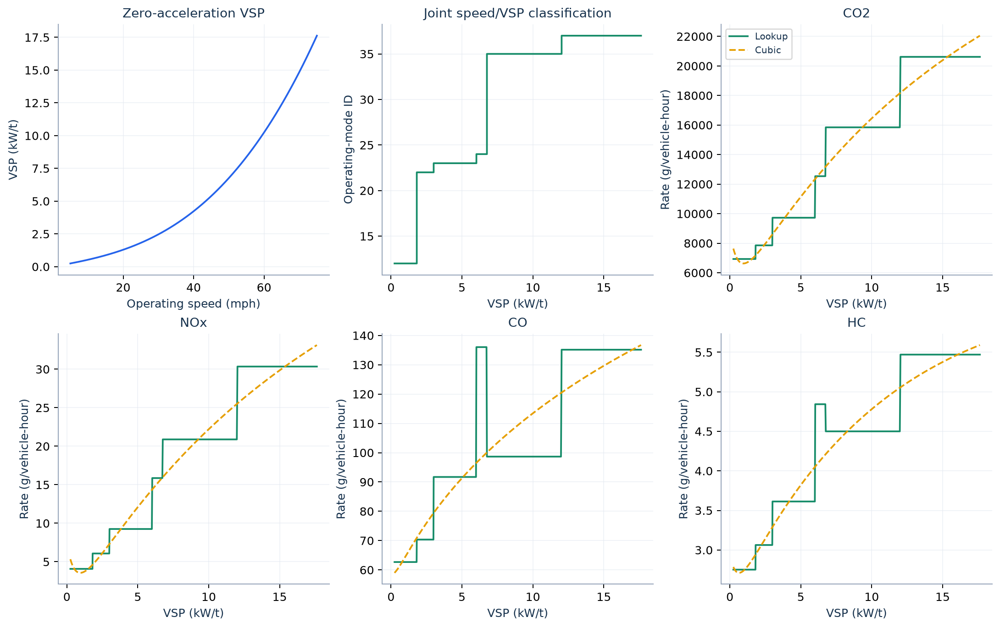

# 6. Vehicle-specific power and emission-rate construction

This common rate calculation is applied **after each method chooses its operating speeds**. It keeps speed → vehicle-specific power (VSP) → operating mode → emission rate visible as separate steps.

| Open | Inputs and calculated output |
|---|---|
| [vsp_input_parameters.csv](vsp_input_parameters.csv) | Vehicle type, mass, resistance coefficients, speed conversion, zero acceleration and zero grade. |
| [vehicle_age_weights.csv](vehicle_age_weights.csv) | All 31 supplied age weights and their normalized weights. |
| [age_rate_contributions.csv](age_rate_contributions.csv) | Each age × mode × pollutant rate multiplied by its normalized weight. |
| [age_weighted_operating_mode_rates.csv](age_weighted_operating_mode_rates.csv) | Summed rates for 23 operating modes, in g/vehicle-hour. |
| [speed_to_vsp_grid.csv](speed_to_vsp_grid.csv) | 701 speeds, individual resistance contributions to VSP, and selected operating mode. |
| [lookup_and_cubic_grid.csv](lookup_and_cubic_grid.csv) | Four pollutants × 701 speeds: lookup, each cubic term, cubic total and rate difference. |
| [cubic_coefficients.csv](cubic_coefficients.csv) | Preserved coefficients, fitting domain and fit diagnostics. |

## VSP before lookup

For speed $v$ in mph, $v_s=0.44704v$ in m/s. With supplied mass $m$ and resistance coefficients $A,B,C_d$,

$$\mathrm{VSP}(v)=\frac{Av_s+Bv_s^2+C_dv_s^3}{m}\quad\text{(kW/t)}.$$

The retained inputs are $m=1.4788$, $A=0.156461$, $B=0.00200193$ and $C_d=0.000492646$. Acceleration is fixed at **0 m/s²**; no grade contribution is included. Derivatives of five-minute detector speeds are not substituted for vehicle acceleration.

Operating-mode selection depends jointly on **speed and VSP**. The implementation uses the following increasing VSP cut points; equality belongs to the next interval:

| Speed band (mph) | VSP cut points (kW/t) | Operating modes in successive intervals |
|---|---|---|
| $0<v<25$ | 0, 3, 6, 9, 12 | 11, 12, 13, 14, 15, 16 |
| $25\le v<50$ | 0, 3, 6, 9, 12, 18, 24, 30 | 21, 22, 23, 24, 25, 27, 28, 29, 30 |
| $v\ge50$ | 6, 12, 18, 24, 30 | 33, 35, 37, 38, 39, 40 |

For $v\le0$, the helper returns mode 1; retained emission observations require positive speed. Invalid speed/VSP is not assigned a valid mode.

## Age mixing and cubic representation

For pollutant $p$, mode $b$ and age $a$, let $z_a$ be the supplied age weight and $e_{pba}$ the input rate:

$$\pi_a=\frac{z_a}{\sum_a z_a},\qquad e_p(v)=\sum_a\pi_ae_{p,b(v),a}.$$

The selected vehicle type is **1**. The four pollutants are CO₂, NOₓ, CO and HC; `NOX` in the source rate table corresponds to `NOx` in result tables. Join age contributions by `age`, `OpModeID`, `pollutant`; join a speed's mode to the mode-rate table using `OpModeID`.

The analytical method uses the preserved cubic approximation

$$\widetilde e_p(v)=c_{0p}+c_{1p}v+c_{2p}v^2+c_{3p}v^3,$$

fitted on 701 evenly spaced speeds from **5 to 75 mph**, with speed in mph. These coefficients are not refitted here. The grid exposes the approximation error; it does not replace the operating-mode lookup used by O, S, R and M.

## Diagnostic figure

[Editable SVG](diagnostic_vsp_and_rates.svg). The first two panels use `speed_to_vsp_grid.csv`; pollutant panels use `lookup_and_cubic_grid.csv`. The latter show rates along the zero-acceleration speed/VSP path. A mode is not a universal function of VSP alone when speed or acceleration assumptions change.

These are rates derived from the supplied MOVES tables, not a new MOVES simulation or measured tailpipe emissions. Original inputs: [emission_input](../../../../data/frozen/calibration/emission_input/). Formula/lookup source: [emissions.py](../../../../src/qvdfe/pipeline/_engine/emissions.py).

Next: [7. Recorded and single-speed calculations](../07_observed_and_single_speed/README.md).
