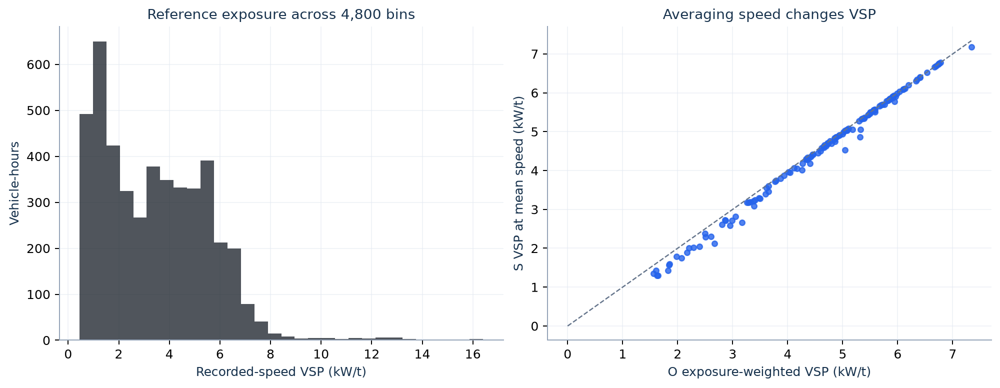

# 7. Recorded-speed reference O and single mean speed S

These calculations use the **same 137 retained episodes** and their 4,800 recorded five-minute bins. They first calculate traffic exposure, then VSP and rate, then emissions. Volume and vehicle-hours are per lane; emission totals are grams per lane over the episode.

| Open in order | Calculation |
|---|---|
| [observed_speed_vsp.csv](observed_speed_vsp.csv) | O: recorded flow/speed → count, travel time, vehicle-hours and individual VSP terms, 4,800 rows. |
| [observed_rate_lookup.csv](observed_rate_lookup.csv) | O: VSP/speed → operating mode → pollutant rate, 19,200 rows. |
| [observed_emission_terms.csv](observed_emission_terms.csv) | O: vehicle-hours × rate, 19,200 bin-pollutant contributions. |
| [single_speed_vsp.csv](single_speed_vsp.csv) | S: episode volume and total vehicle-hours → one mean speed and its VSP, 137 rows. |
| [single_speed_rate_lookup.csv](single_speed_rate_lookup.csv) | S: one mode/rate for each episode-pollutant, 548 rows. |
| [single_speed_emission_terms.csv](single_speed_emission_terms.csv) | S: observed total vehicle-hours × mean-speed rate, 548 totals. |

Join O tables by `episode_id`, `bin_index` and, for rates/emissions, `pollutant`. Join S tables by `episode_id` and `pollutant`. `bin_index` is local to its episode; it is not a globally unique time index.

## O: calculate each five-minute contribution, then add

With $\Delta t=1/12$ h, recorded flow $q_i$ (veh/h/lane), recorded speed $v_i$ (mph), length $L$ (mi), and the common lookup $e_p(v)$ (g/vehicle-hour):

$$n_i=q_i\Delta t,\qquad T_i=L/v_i,\qquad H_i=n_iT_i,$$
$$z_i=\mathrm{VSP}(v_i),\qquad e_{pi}=e_p(v_i),\qquad
E_{O,p}=\sum_iH_ie_{pi}.$$

The five-minute bin supplies a count and a link-travel-time proxy. $H_i$ is **not** $n_i\Delta t$: vehicles are assigned travel time $L/v_i$, which can differ from five minutes. The full interval $[t_0,t_3)$ is retained.

## S: preserve total observed travel time, replace rate variation

$$D=\sum_i n_i,\qquad H_O=\sum_iH_i,\qquad
v_S=\frac{DL}{H_O}=\frac{\sum_i n_i}{\sum_i n_i/v_i},$$
$$z_S=\mathrm{VSP}(v_S),\qquad E_{S,p}=H_Oe_p(v_S).$$

S uses a **volume-weighted harmonic speed**, not the arithmetic mean of the five-minute speeds. O and S have exactly the same $D$ and $H_O$; their difference is the replacement of time-varying rates by one lookup rate. In general,

$$\mathrm{VSP}(v_S)\ne\frac{\sum_iH_i\mathrm{VSP}(v_i)}{H_O},\qquad
e_p(v_S)\ne\frac{\sum_iH_ie_p(v_i)}{H_O}.$$

This explains why closeness of average speed or travel time does not imply identical emissions. S's use of observed vehicle-hours also differs from R, M and A, which use calibrated predicted delay. It is an observed-input approximation, not a traffic forecast with the same information as those methods.

## Diagnostic figure

[Editable SVG](diagnostic_observed_and_mean_vsp.svg). Left: `observed_speed_vsp.csv`, histogram weighted by `vehicle_hours`. Right: O's exposure-weighted VSP versus S's VSP, one point per episode, from [step 8's VSP summary](../08_reconstruction_and_two_speed/vsp_agreement_by_episode_method.csv). The dashed line is equality. The comparison is with a **recorded-speed, zero-acceleration proxy**; detector point speeds are not measured link trajectories or measured emissions.

Next: [8. Reconstructed and two-speed calculations](../08_reconstruction_and_two_speed/README.md).
