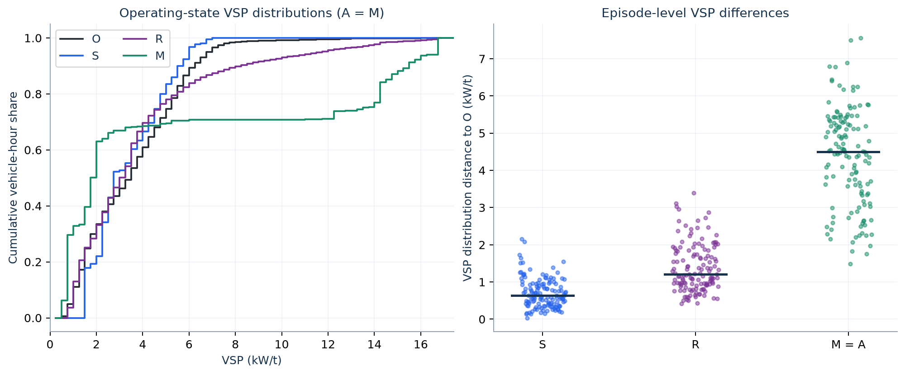

# 8. Reconstructed speed R and two-speed methods M and A

These methods use each retained episode's common volume $D$, free-flow time $T_f$, predicted duration $\widehat P$, peak delay $\widehat w_{max}$ and mean delay $\widehat{\bar w}=\theta\widehat w_{max}$. Their operating speeds differ; all speeds are passed through VSP before lookup. A shares M's speeds and VSP, but uses cubic emission rates.

| Open in order | Calculation |
|---|---|
| [reconstructed_speed_vsp.csv.gz](reconstructed_speed_vsp.csv.gz) · [24-row preview](reconstructed_speed_vsp_preview.csv) | R: 384 integration nodes per episode; shape, arrival factor, vehicle weight, delay, speed, VSP terms and two-speed time allocation. Full table: 52,608 rows. |
| [reconstructed_rate_lookup.csv.gz](reconstructed_rate_lookup.csv.gz) · [preview](reconstructed_rate_lookup_preview.csv) | R: node speed/VSP → mode → pollutant rate; 210,432 rows. |
| [two_speed_state_vsp.csv](two_speed_state_vsp.csv) | M/A: free and congested operating states, VSP terms, mean residence times and vehicle-hours; 274 rows. |
| [two_speed_lookup_and_cubic_rates.csv](two_speed_lookup_and_cubic_rates.csv) | M/A: same state/mode, lookup versus cubic terms/rate; 1,096 rows. |
| [node_emission_terms.csv.gz](node_emission_terms.csv.gz) · [preview](node_emission_terms_preview.csv) | R, M and A contributions by node and pollutant, including separate free/queue contributions; 210,432 rows. |
| [profile_conservation_checks.csv](profile_conservation_checks.csv) | Solved profile exponent/family and one row per episode checking volume, mean delay, distance, time, equivalent speed and nonnegative time allocation. |
| [vsp_agreement_by_episode_method.csv](vsp_agreement_by_episode_method.csv) | VSP mean and distribution differences from O, for 137 episodes × five methods. |
| [operating_mode_exposure_by_episode.csv](operating_mode_exposure_by_episode.csv) | Vehicle-hours and shares by episode, method and operating mode. |
| [pooled_vsp_exposure_distribution.csv](pooled_vsp_exposure_distribution.csv) | All-episode vehicle-hour-weighted VSP histogram and cumulative share, separately normalized for each method. |

The compressed CSVs contain **all rows**. Previews show only the first 24 rows and must not be used as the calculation sample. Expand `.csv.gz` before opening in a spreadsheet. Join node tables by `episode_id`, `node_index`, `pollutant`; state tables by `episode_id`, `state`, `pollutant`. These integration nodes are **not five-minute clock-time bins**.

## Reconstruct delay and conserved vehicle weights

Let $u\in[0,1]$ denote normalized episode time and $h(u)$ its dimensionless delay shape:

$$w(u)=\widehat w_{max}h(u),\qquad T(u)=T_f+w(u),\qquad v_R(u)=L/T(u).$$

For $\theta\le2/3$, $h(u)=[4u(1-u)]^a$, with $a$ chosen so that $\int_0^1h(u)\,du=\theta$. For $\theta>2/3$, $h(u)=1-|2u-1|^a$ with $a=\theta/(1-\theta)$. Both profiles are zero at their endpoints, equal one at the midpoint, and have the requested mean.

Using **384 Gauss–Legendre nodes** $u_j$ and quadrature weights $g_j$:

$$\lambda_j=1+\frac{\widehat w_{max}}{\widehat P}h'(u_j),\qquad N_j=Dg_j\lambda_j.$$

The closed-profile test requires nonnegative implied arrival rates (within numerical tolerance). The resulting weights satisfy $\sum_jN_j\approx D$ and $\sum_jN_jw_j/D\approx\widehat{\bar w}$. Predicted total vehicle-hours are $H_P=D(T_f+\widehat{\bar w})$.

## R: reconstructed equivalent speed and lookup

$$z_{Rj}=\mathrm{VSP}(v_{Rj}),\qquad
E_{R,p}=\sum_jN_jT_j e_p(v_{Rj}).$$

R applies the common zero-acceleration lookup to each equivalent whole-link speed. It does not infer acceleration from the reconstructed curve.

## M and A: free and congested operating states

The state speeds are $v_f$ and $\widehat v_q$ from the FD. At each node,

$$t_{qj}=\frac{v_fw_j}{v_f-\widehat v_q},\qquad
t_{fj}=T_f-\frac{\widehat v_qw_j}{v_f-\widehat v_q},$$
$$t_{fj}+t_{qj}=T_j,\qquad v_ft_{fj}+\widehat v_qt_{qj}=L.$$

Thus the implied average speed is $L/T_j$, the same equivalent speed as R. **The rates are evaluated at different operating speeds:** R uses $v_{Rj}$, while M uses $v_f$ and $\widehat v_q$.

$$E_{M,p}=\sum_jN_j[t_{fj}e_p(v_f)+t_{qj}e_p(\widehat v_q)],$$
$$E_{A,p}=\sum_jN_j[t_{fj}\widetilde e_p(v_f)+t_{qj}\widetilde e_p(\widehat v_q)].$$

Because state rates are constant within an episode, totals also follow analytically by substituting $\widehat{\bar w}$ for $w_j$ in the time-allocation equations and multiplying the two mean contributions by $D$. The node sums agree within quadrature tolerance: the largest relative difference is $1.57\times10^{-10}$. Step 9 exports the residuals explicitly. A and M have identical traffic exposure and VSP distributions. Their only difference here is lookup versus cubic rate representation.

## VSP comparison: exposure distributions, not trajectory errors

Every method's VSP distribution is weighted by **vehicle-hours**: O uses $n_iL/v_i$, S uses one mass $H_O$, R uses $N_jT_j$, and M/A use free and queue vehicle-hours. Each distribution is normalized to sum to one before comparison.

For normalized VSP cumulative distributions $F_m$ and $F_O$, the one-dimensional Wasserstein distance is

$$W_1(m,O)=\int_{-\infty}^{\infty}|F_m(z)-F_O(z)|\,dz\quad\text{(kW/t)}.$$

This summarizes a difference between distributions; it does not match a reconstructed node to an observed five-minute timestamp. The operating-mode total variation is

$$\mathrm{TV}(m,O)=\tfrac12\sum_b|s_{mb}-s_{Ob}|,$$

where $s_{mb}$ is that method's vehicle-hour share in mode $b$. TV ranges from zero (same shares) to one (disjoint mode exposure). It ignores the total vehicle-hour difference, which is separately reported.

## Diagnostic figure

[Editable SVG](diagnostic_vsp_distributions.svg). Left: `pooled_vsp_exposure_distribution.csv`, using 0.25 kW/t histogram bins over 0–32 kW/t and all-episode exposure weights. Right: one Wasserstein-distance point per episode from `vsp_agreement_by_episode_method.csv`; short horizontal marks are medians, and horizontal spreading is only for visibility. M and A coincide in VSP, so one series represents both.

These distances describe agreement with O's **recorded-speed, zero-acceleration proxy**, not measured vehicle-trajectory VSP or physical ground truth. Source: [profile and emission equations](../../../../src/qvdfe/pipeline/_engine/model.py). Next: [9. Totals and comparison](../09_totals_and_comparison/README.md).
