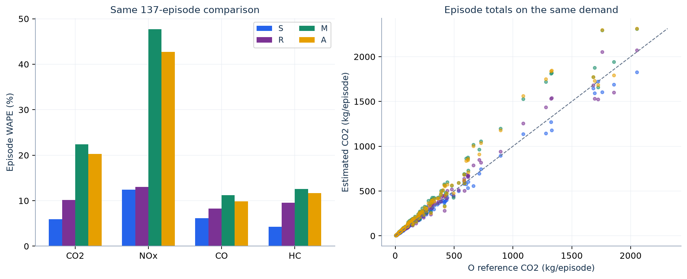

# 9. Episode totals, pooled errors and error components

All five principal methods use the **same episode demand**. The final comparison is between episode totals, after summing their bin/node/state contributions; it is not a WAPE of individual five-minute rates.

| Open | Result and interpretation |
|---|---|
| [episode_pollutant_calculation_steps.csv](episode_pollutant_calculation_steps.csv) | 137 episodes × four pollutants = 548 rows. Observed/predicted vehicle-hours, state times/rates, baseline and congestion terms, O/S/R/M/A totals and signed error components. |
| [pooled_metric_calculation_steps.csv](pooled_metric_calculation_steps.csv) | Numerators, denominators and final WAPE, bias, RMSE and $R^2$ for all 137, Arizona and California separately. Includes the additional `S_pred` diagnostic. |
| [archived_result_reconciliation.csv](archived_result_reconciliation.csv) | All 137 × five principal methods × four pollutants = **2,740 totals**, recomputed versus archived, with absolute and relative differences. |

Use `episode_id` and `pollutant` to join totals to earlier calculations. CO₂, NOₓ, CO and HC are separate outcomes; their gram quantities are not added together. Totals are grams per lane, vehicle-hours are veh·h/lane, speeds are mph, and mean travel times are hours.

## Equivalent total formulas

Let $e_f=e_p(v_f)$, $e_q=e_p(\widehat v_q)$ and let $\bar t_f,\bar t_q$ be the mean free/queue times from step 8:

$$E_{M,p}=D(\bar t_fe_f+\bar t_qe_q)
=DT_fe_f+D\widehat{\bar w}\,\Gamma_p,$$
$$\Gamma_p=\frac{v_fe_q-\widehat v_qe_f}{v_f-\widehat v_q}.$$

The table shows both state contributions and the equivalent baseline-plus-delay form. A uses the same equations with cubic rates $\widetilde e_p$. $\Gamma$ and the incremental congestion term remain **signed**; no truncation to zero is applied. A negative increment means this rate/state combination gives a lower total than its all-free-speed baseline, not negative total emissions.

## Pooled error calculation

For episode $e$, model $m$ and one pollutant, define $\varepsilon_e=E_{m,e}-E_{O,e}$. The pooled calculations are

$$\mathrm{WAPE}_m=100\frac{\sum_e|\varepsilon_e|}{\sum_e|E_{O,e}|},\qquad
\mathrm{Bias}_m=100\frac{\sum_e\varepsilon_e}{\sum_eE_{O,e}},$$
$$\mathrm{RMSE}_m=\sqrt{\frac{\sum_e\varepsilon_e^2}{N}},\qquad
R_m^2=1-\frac{\sum_e\varepsilon_e^2}{\sum_e(E_{O,e}-\overline E_O)^2}.$$

`sum_abs_error_g` is WAPE's numerator and `sum_reference_g` its denominator (all reference totals are positive). **Absolute errors are taken episode by episode before summing**, so opposing errors do not cancel. Bias uses the signed sum and can cancel. The per-episode absolute percentage error column is $100|\varepsilon_e|/E_{O,e}$; the reported WAPE is not its equally weighted mean. It is the reference-emission-weighted mean.

The metric table has 60 rows: three samples × four pollutants × S, `S_pred`, R, M and A. O is the reference and has no nonzero comparison error. `S_pred` is an explanatory calculation, not a sixth principal model:

$$H_P=D(T_f+\widehat{\bar w}),\quad v_{S,pred}=DL/H_P,\quad
E_{S,pred}=H_Pe_p(v_{S,pred}).$$

The episode table includes this diagnostic speed, VSP, operating-mode ID and lookup rate. It also gives `M_node_minus_analytic_g` and `A_node_minus_analytic_g`, the small quadrature residuals against the analytic totals.

## How the error components add

The signed columns form the exact sequence

$$E_A-E_O=(E_S-E_O)+(E_{S,pred}-E_S)+(E_R-E_{S,pred})+(E_M-E_R)+(E_A-E_M).$$

| Difference | What is replaced at this step |
|---|---|
| S − O | Observed time-varying rate exposure by one observed-mean-speed rate; observed vehicle-hours retained. |
| `S_pred` − S | Observed vehicle-hours and equivalent mean speed by those implied by predicted mean delay. |
| R − `S_pred` | One predicted-mean-speed rate by reconstructed-speed rate variation, at the same predicted total vehicle-hours. |
| M − R | Equivalent whole-link operating speeds by free/queue operating states, retaining predicted travel time. |
| A − M | Operating-mode lookup rates by cubic rates, retaining the same two states and time allocation. |

These are ordered, signed accounting differences. They are not independent causal effects or percentages of an absolute error, and cancellation is possible.

## Diagnostic figure

[Editable SVG](diagnostic_emission_comparison.svg). Left: `pooled_metric_calculation_steps.csv`, sample `All 137`, principal comparison methods S/R/M/A. Right: CO₂ episode totals from `episode_pollutant_calculation_steps.csv`, converted from grams to kilograms; the dashed line is equality. Color meanings are consistent across the steps: O black, S blue, R purple, M green, A orange.

The 137 are a selected subset of fitted average-profile episodes. O is an estimate based on recorded five-minute point speeds treated as whole-link travel speeds, with zero acceleration. Agreement with O quantifies that common-proxy comparison; it does not establish tailpipe accuracy or superiority against observed trajectories. S also uses observed vehicle-hours, while R/M/A use calibrated predicted delay, so their information inputs differ.

The numerical reconciliation reproduces all 2,740 frozen totals (maximum relative difference approximately $3.07\times10^{-13}$) and the 20 all-sample metric rows including `S_pred`. The historical 137-episode report and deeper error interpretation remain in [debug/episodes_137](../../../episodes_137/README.md).
