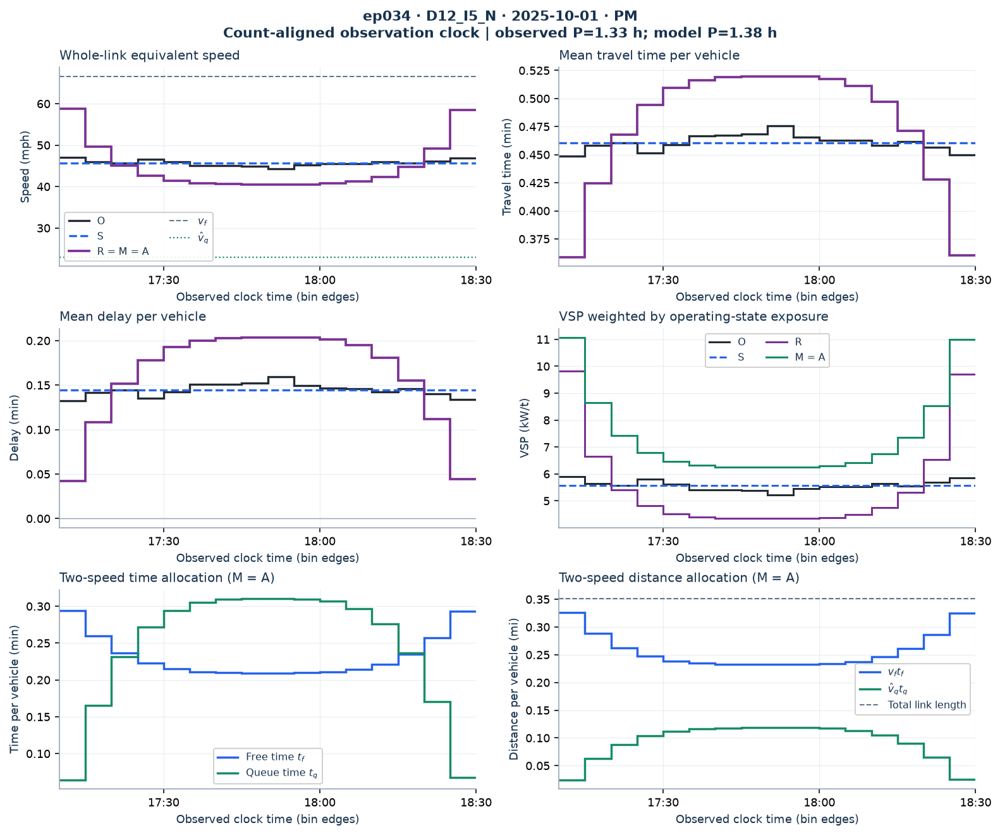
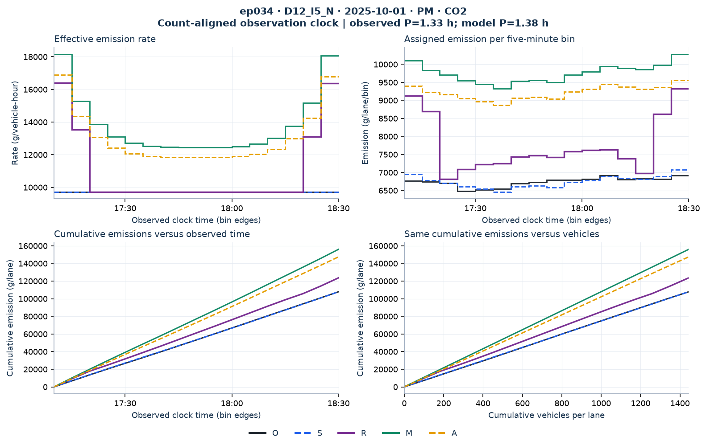
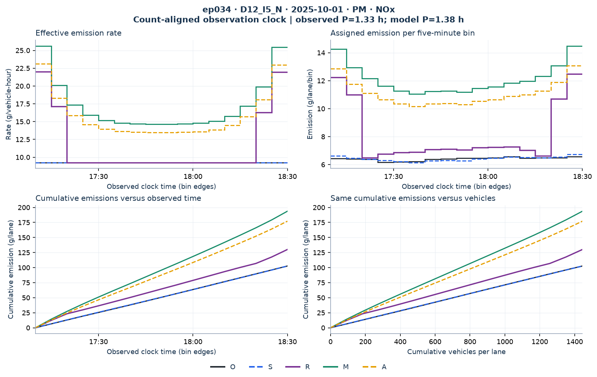
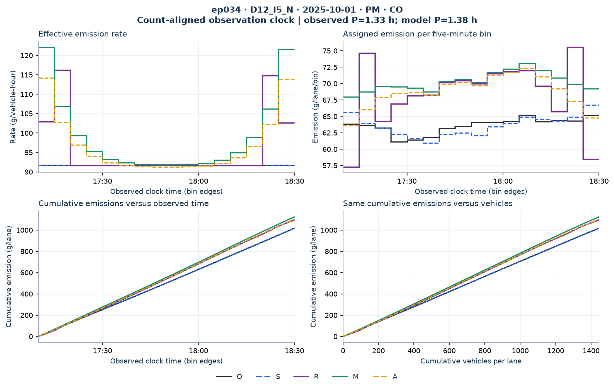
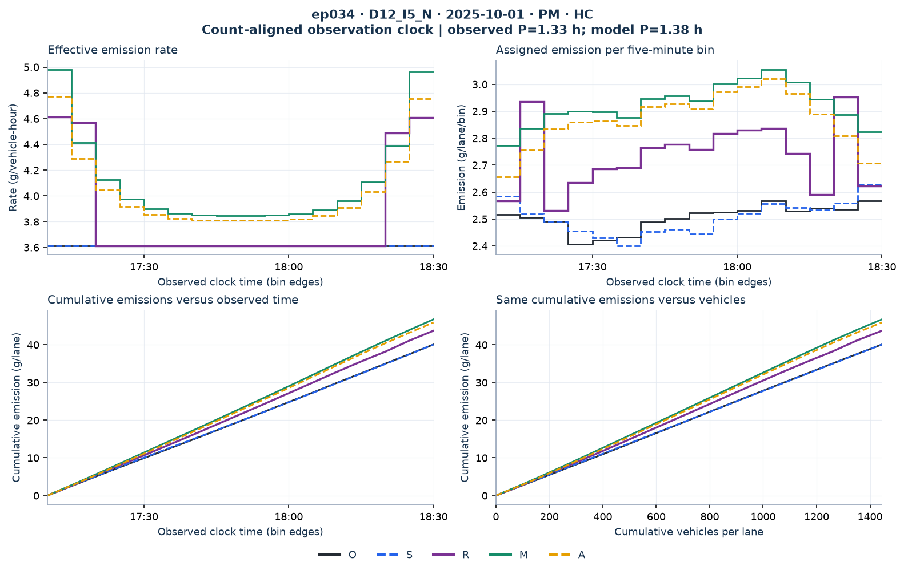

# ep034: D12_I5_N, 2025-10-01, PM

[All episodes](../../EPISODES.md) · [Calculation guide](../../README.md) · [Interactive local page](index.html)

Original ID: `state_transition__PeMS::D12_I5_N::L5N-072__2025-10-01__084`. Observed duration 1.333 h; predicted duration 1.378 h; 1444.7 vehicles/lane.

Model vehicle groups are aligned to recorded five-minute bins by cumulative count. This preserves totals and is a diagnostic comparison, not measured trajectories. R/M/A share travel time, delay and equivalent speed; M/A share operating-state VSP.

[Traffic CSV](traffic_timeseries.csv) · [All-pollutant emission CSV](emissions_timeseries.csv) · [Error metrics CSV](error_metrics.csv) · [Allocation CSV](node_to_bin_allocation.csv)

The local HTML dashboard has a separate traffic page and one page per pollutant, each with one results table beside its figure. Use the collapsible sidebar to navigate. Scalar episode targets use APE; five-minute profiles use WAPE against O. Full bias, MAE and RMSE are in the error metrics CSV.

## Traffic

[Editable SVG](traffic_profiles.svg)

## CO2

[Editable SVG](emissions_CO2.svg)

## NOx

[Editable SVG](emissions_NOx.svg)

## CO

[Editable SVG](emissions_CO.svg)

## HC

[Editable SVG](emissions_HC.svg)
