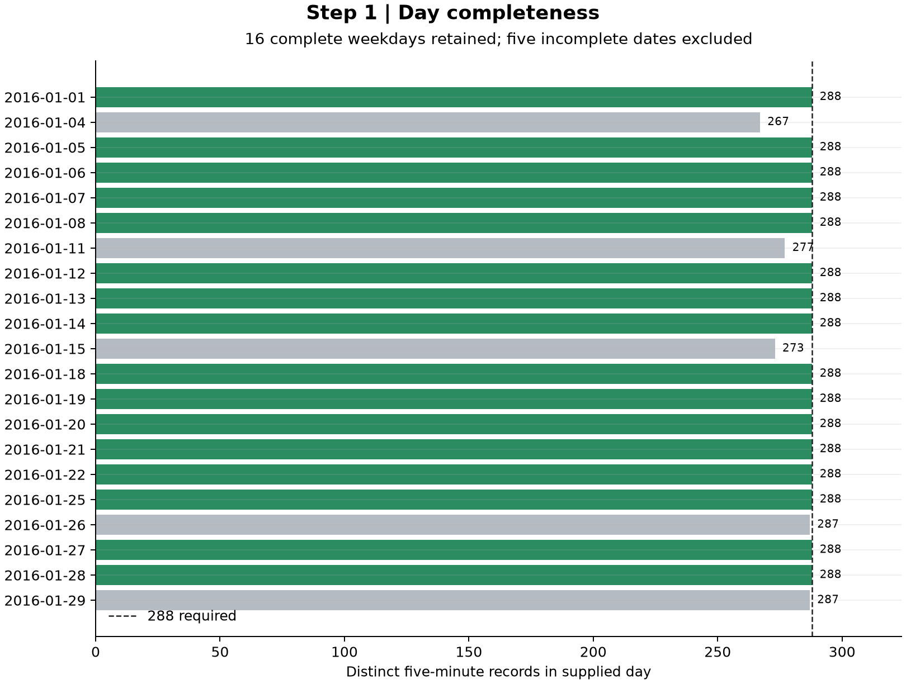

# 1. Raw records and complete-day screening

**Input:** [canonical raw records](../../../../data/inputs/detector78/raw_5min.csv), with equivalent full-precision records in `raw_source.json`.

| Result | What is exposed |
| --- | --- |
| [Raw-record decisions](raw_record_decisions.csv) | All 5,999 records; separate weekday, speed and count flags; retained-day membership; count/speed. |
| [Day decisions](day_decisions.csv) | All 21 dates; row count, distinct times, valid-row count and reason for retention/exclusion. |

A record is valid when its date is Monday–Friday, $0<v\le90$ mph, and count $d\ge0$. A day is retained only if it has **288 records**, **288 distinct times** and **all records valid**. The existing supplied timestamps are five-minute times. No gaps are filled and no retained speeds are smoothed in this worked example.

**Output:** 16 complete days, with 4,608 contributing records. Five incomplete days fail the completeness rule. This screen belongs to this separately supplied detector-78 example; it is not a new screen for the 137-episode paper sample.

`source_retained_date` is preserved evidence, not a calculation flag. Likewise, the original `source_travel_time_h` remains visible, but travel times are recalculated as $L/v$. Counts are assumed already per represented lane: the multiplier is **1**, and they are not divided by the detector's five lanes.

The figure checks day completeness: green days meet the retained-day rule, gray days are incomplete. [Editable SVG](diagnostic.svg).

[Next: average weekday](../02_average_weekday/README.md) · [All steps](../README.md)
