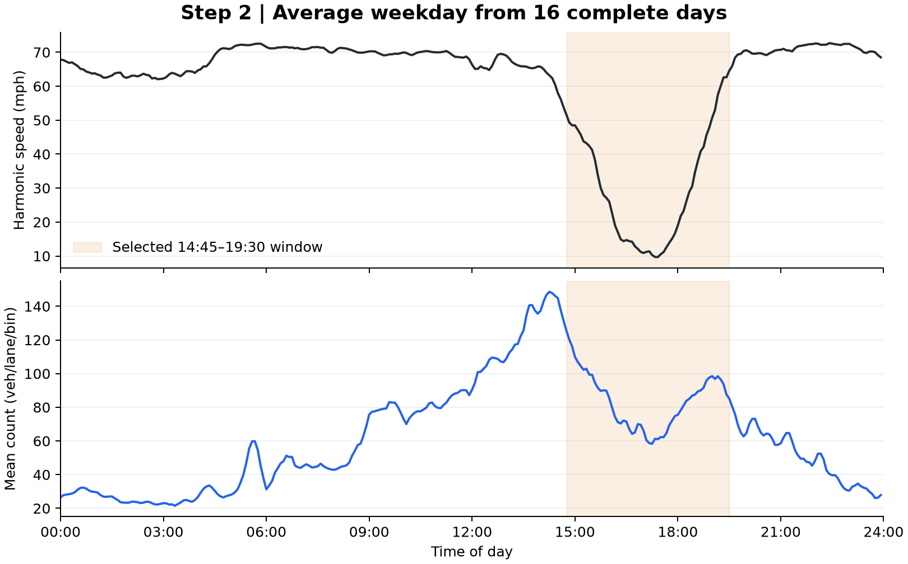

# 2. Construct the average weekday

**Input:** the 16 retained days from step 1. For each time-of-day bin $i$, [the arithmetic table](average_weekday_arithmetic.csv) exposes both sums before the division:

$$d_i=\frac{1}{16}\sum_{d=1}^{16}d_{di},\qquad v_i=\frac{\sum_d d_{di}}{\sum_d d_{di}/v_{di}}.$$

Counts use an arithmetic average; speeds use the count-weighted harmonic average. Averaging speeds arithmetically would change the vehicle-hours and is not used here. `sum_count_over_speed` is the denominator, built from the individual record contributions in step 1.

**Output:** 288 average-weekday bins, each with 16 contributing days. The entire daily profile is retained so the selected window can be inspected in context.

The speed series is the observed-proxy input to the report's detector-78 profiles; step 3 selects the displayed interval.

The figure shows the full daily speed and count profile; shading identifies the fixed example window. [Editable SVG](diagnostic.svg).

[Next: selected window](../03_selected_window/README.md) · [All steps](../README.md)
