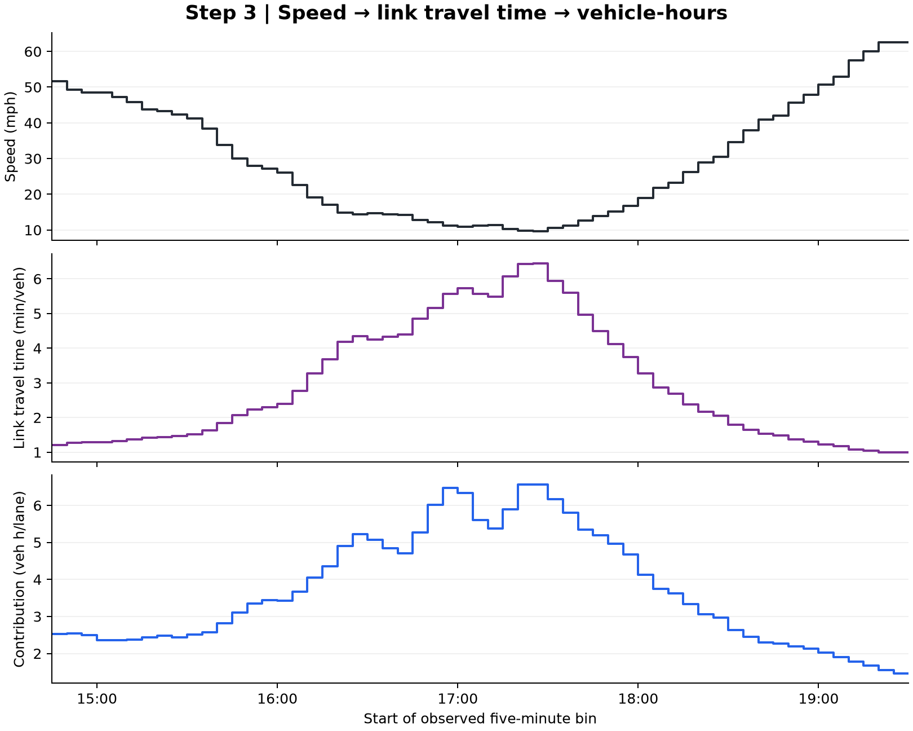

# 3. Select the window and calculate observed traffic quantities

**Input:** the average-weekday profile and calibrated link length $L=1.0400000000000205$ mi.

The window is fixed at **14:45 inclusive to 19:30 exclusive**. It contains 57 five-minute bins, spanning 4.75 h. This explanatory example does not redetect episode boundaries.

In [selected-window arithmetic](selected_window_arithmetic.csv), calculate:

$$T_i=L/v_i,\qquad H_i=d_iT_i,\qquad D=\sum_i d_i,\qquad H_O=\sum_i H_i.$$

`cum_count_start` and `cum_count_end` are the observed cumulative-count boundaries later used for alignment. `cum_vehicle_hours` shows how $H_O$ accumulates.

**Output:** $D=4789.25$ veh/lane and $H_O=211.4339564$ veh h/lane. The resulting single mean speed is $DL/H_O=23.5573324$ mph. These calculations use the original count-weighted profile without clipping it to the calibrated free-flow speed.

The observed speed in the common-clock plot and the O emission series use these 57 rows.

The figure shows how a low observed-proxy speed increases link travel time and vehicle-hours. [Editable SVG](diagnostic.svg).

[Next: fitted traffic calculation](../04_traffic_calculation/README.md) · [All steps](../README.md)
