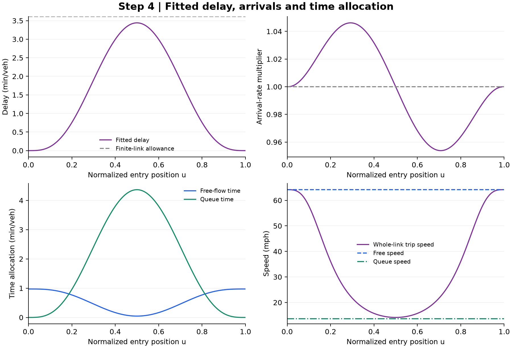

# 4. Calculate fitted traffic and two-speed time allocation

**Inputs:** [parameters](input_parameters.csv) reuse the detector card and AZ_I10_W PM corridor-direction calibration from **38 source episodes**. No parameter is refitted for this worked example.

[Traffic arithmetic](traffic_arithmetic.csv) gives a numerical result beside each formula:

$$x=D/C,\quad T_f=L/v_f,\quad P=\max(f_dx^n,x),$$
$$w_{\max}=T_ff_pP^s,\quad \bar w=\theta w_{\max},\quad \mu=D/P,$$
$$\omega=\frac{C}{k_j-C/v_f},\qquad v_q=\frac{\mu}{k_j-\mu/\omega}.$$

Here $x$ has units of **hours**, not a dimensionless hourly demand/capacity ratio. Jam density is fixed at 220 veh/mi/lane.

For reconstructed entry position $u\in[0,1]$:

$$h(u)=[4u(1-u)]^a,\qquad w(u)=w_{\max}h(u),\qquad 4^a B(a+1,a+1)=\theta.$$

The [60-step bisection record](shape_bisection.csv) starts from $a\in[1,10000]$. This follows the current Python analysis; the Excel helper uses 50 iterations. The selected $\theta=0.434829$ uses this beta-shape branch.

Each of the [384 quadrature rows](quadrature_traffic_arithmetic.csv) exposes:

$$N_j=Dg_j[1+(w_{\max}/P)h'(u_j)],\quad T_j=T_f+w(u_j),\quad v_{R,j}=L/T_j,$$
$$t_{q,j}=\frac{v_fw(u_j)}{v_f-v_q},\qquad t_{f,j}=T_f-\frac{v_qw(u_j)}{v_f-v_q}.$$

The rows verify $v_ft_{f,j}+v_qt_{q,j}=L$ and $t_{f,j}+t_{q,j}=T_j$. Mean times use the same equations with $\bar w$. Counts sum to $D$ and vehicle-hours to $D(T_f+\bar w)$.

Physical checks require $0<v_q<v_f$, nonnegative arrival weights and $w_{\max}\le L(1/v_q-1/v_f)$. The peak free-flow time is **0.000769566 h**, positive. The modeled duration is **4.449460 h**; step 7 aligns its groups to the observed 4.75 h clock for display.

The figure checks the fitted delay against the finite-link allowance, arrival weights, positive time allocation and whole-link versus operating speeds. [Editable SVG](diagnostic.svg).

[Next: emission rates](../05_emission_rates/README.md) · [All steps](../README.md)
