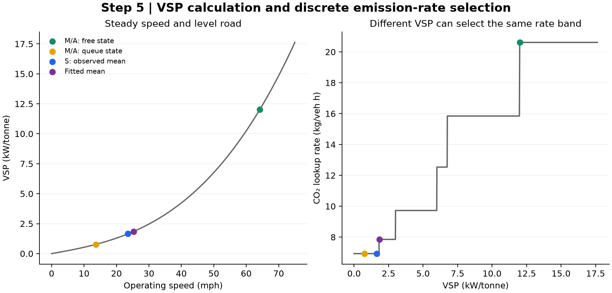

# 5. Calculate VSP, then select emission rates

**Input:** supplied passenger-car emission rates, vehicle parameters, age mixture and existing cubic coefficients in [canonical calibration inputs](../../../../data/inputs/detector78/calibration_inputs.json).

| Table | Arithmetic exposed |
| --- | --- |
| [Per-method VSP arithmetic](method_vsp_arithmetic.csv) | Operating speed → m/s → three road-load power terms → VSP, with time exposure. |
| [Separate lookup decisions](method_lookup_decisions.csv) | Join by `vsp_record_id`: speed class plus VSP → operating mode → four lookup rates. A's lookup rows are comparison only; A actually uses cubic rates. |
| [Normalized age weights](normalized_age_weights.csv) | $\pi_a=W_a/\sum_bW_b$ for 31 ages. |
| [Age-rate contributions](age_rate_contributions.csv) | Each raw age/mode/pollutant rate and $\pi_a r_{a,m,p}$. |
| [Weighted operating-mode rates](age_weighted_mode_rates.csv) | $r_{m,p}=\sum_a\pi_a r_{a,m,p}$; 23 modes × four pollutants. |
| [Positive-speed lookup bands](positive_speed_rate_bands.csv) | Nine speed intervals × four pollutants; exact inclusive/exclusive boundaries. |
| [Vehicle/VSP inputs](vehicle_vsp_inputs.csv) | All coefficients used to map speed to operating mode. |
| [Cubic coefficients](cubic_coefficients.csv) | Supplied $c_0,c_1,c_2,c_3$ and fit domain. |
| [Operating-state arithmetic](state_rate_arithmetic.csv) | VSP, selected mode, lookup rate and four separate cubic terms at $v_f,v_q,DL/H_O,DL/H_P$. |

With $s_v=0.44704v$ in m/s and the supplied vehicle coefficients:

$$\mathrm{VSP}(v)=\frac{A s_v+B s_v^2+C_d s_v^3}{m}.$$

Acceleration and road grade are **zero**. VSP and speed thresholds determine the operating mode; the positive-speed intervals encode the same mapping. Select the interval containing $v$; **do not interpolate** between bands. The first interval excludes zero and the last has no finite upper bound.

O has 57 operating-speed rows; S has one; R has 384 reconstructed groups; M and A each have a free and queue row for every group. M/A have identical VSP and time exposure. A changes only the rate representation. In this example, queue VSP **0.7690** and S VSP **1.6534 kW/tonne** both select mode 12. The fitted mean VSP **1.8492** selects mode 22 because its speed exceeds 25 mph. A VSP difference need not produce a rate difference, and the speed-class boundary also matters.

$$\widetilde r_p(v)=c_{0,p}+c_{1,p}v+c_{2,p}v^2+c_{3,p}v^3.$$

All rates are g/(veh h). The cubic fit domain is **5–75 mph**; the free and queue speeds used by A lie within it. This step evaluates the existing coefficients and does not refit them. Original MOVES scenario settings were not recorded with the supplied export and are not inferred here.

The figure separates the continuous VSP calculation from the discrete CO2 rate selection. [Editable SVG](diagnostic.svg).

[Next: five methods](../06_method_calculations/README.md) · [All steps](../README.md)
