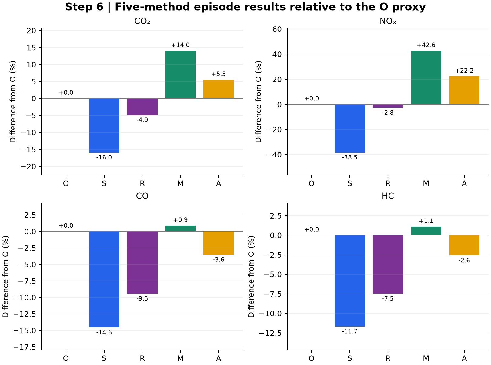

# 6. Calculate all five methods

Each table includes **CO2, NOx, CO and HC**. Rates are g/(veh h), times h/veh, and emissions g/lane.

| Method and result table | Calculation | Rows |
| --- | --- | --- |
| [O: recorded-speed proxy](O_calculation_rows.csv) | $E_{O,p}=\sum_i d_i(L/v_i)r_p(v_i)$ | 57 bins × 4 pollutants |
| [S: one mean speed](S_calculation_rows.csv) | $v_S=DL/H_O$; $E_{S,p}=H_Or_p(v_S)$ | 4 pollutants |
| [R: reconstructed trip speeds](R_calculation_rows.csv) | $E_{R,p}=\sum_jN_jT_jr_p(L/T_j)$ | 384 nodes × 4 pollutants |
| [M: two operating speeds, lookup](M_calculation_rows.csv) | $E_{M,p}=\sum_jN_j[t_{f,j}r_p(v_f)+t_{q,j}r_p(v_q)]$ | 384 nodes × 4 pollutants |
| [A: two operating speeds, cubic](A_calculation_rows.csv) | Replace both M lookup rates with $\widetilde r_p$ | 384 nodes × 4 pollutants |

O and R expose speed, VSP, selected mode, rate, vehicle-hours and emission for each row. M and A expose free and queue times, vehicle-hours, rates and emission contributions separately. `node_id` joins the fitted traffic arithmetic in step 4. S preserves the observed vehicle-hours; R/M/A preserve the same fitted vehicle-hours.

For constant $v_f,v_q$, the node sums for M and A also equal the mean-time expressions:

$$E_{M,p}=D[\bar t_f r_p(v_f)+\bar t_qr_p(v_q)],\quad E_{A,p}=D[\bar t_f\widetilde r_p(v_f)+\bar t_q\widetilde r_p(v_q)].$$

The per-node extension makes the time allocation inspectable and supports the common-clock figures; it does not change the original aggregate two-speed totals. The quadrature weights $N_j$ represent modeled groups, not 384 observed bins or measured individual trajectories.

The figure compares all five totals against O for each pollutant; these discrepancies are not errors against measured emissions. [Editable SVG](diagnostic.svg).

[Next: common-clock allocation](../07_common_clock/README.md) · [All steps](../README.md)
