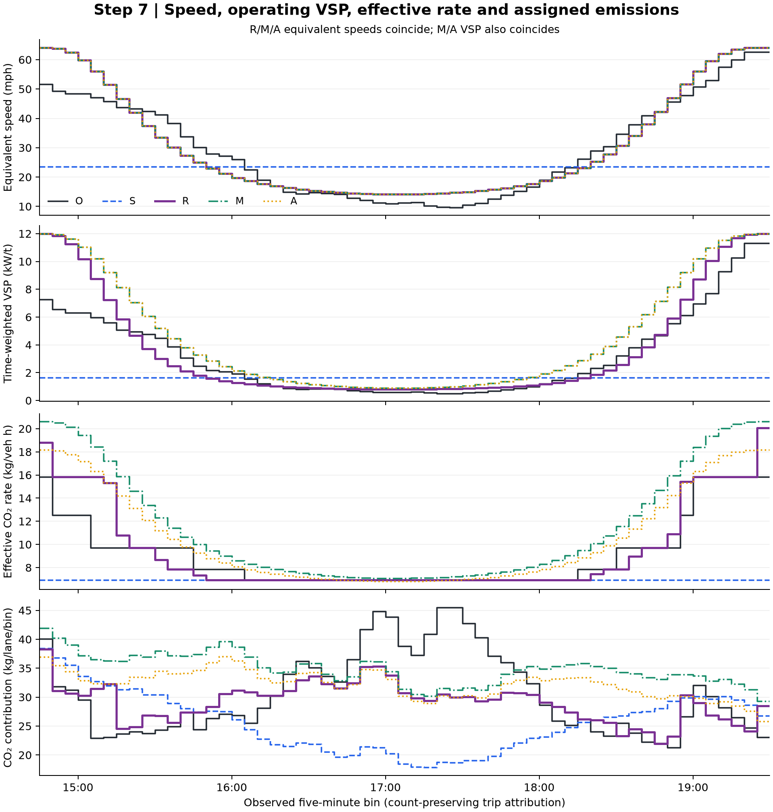

# 7. Put all methods on the observed five-minute clock

The [440 nonzero node-to-bin allocations](node_to_bin_allocation.csv) expose how the 384 modeled groups are split across 57 observed bins. Let $B_i$ be cumulative observed count and $Q_j$ cumulative modeled count:

$$n_{ij}=\max\{0,\min(B_i,Q_j)-\max(B_{i-1},Q_{j-1})\},\qquad f_{ij}=n_{ij}/N_j.$$

Use the bin boundaries from step 3 and the node boundaries from step 4. `overlap_count` is $n_{ij}$; `node_fraction` is $f_{ij}$. For R/M/A:

$$H_i=\sum_j n_{ij}T_j,\qquad E_{i,m,p}=\sum_j f_{ij}E_{j,m,p}.$$

O retains its recorded-bin calculation. S allocates its constant per-vehicle values: $H_{i,S}=d_iH_O/D$ and $E_{i,S,p}=d_iE_{S,p}/D$.

The [common-clock table](common_clock_calculations.csv) has **1,140 rows**: 57 bins × five methods × four pollutants. It then calculates:

$$v_i^{eff}=d_iL/H_i,\qquad r_{i,p}^{eff}=E_{i,p}/H_i,\qquad E_{i,p}^{cum}=\sum_{k\le i}E_{k,p}.$$

R/M/A have the same equivalent speeds because they have the same bin distance and vehicle-hours; their rates and emissions differ. An effective R rate is the time-weighted group rate, generally not the lookup rate at its effective speed.

The separate [VSP time series](common_clock_vsp.csv) uses operating-time weights. For R, $Z_{i,R}=\sum_j n_{ij}T_j\,\mathrm{VSP}(v_{R,j})/H_i$. For M/A:

$$Z_{i,M}=Z_{i,A}=\frac{\sum_jn_{ij}[t_{f,j}\mathrm{VSP}(v_f)+t_{q,j}\mathrm{VSP}(v_q)]}{H_i}.$$

The table also reports VSP at the equivalent speed as a separate diagnostic; it is **not** used to replace the operating-state VSP or to calculate an emission rate. O uses $\mathrm{VSP}(v_i)$ and S uses $\mathrm{VSP}(v_S)$.

**Figure source:** these columns reproduce the all-method speed, effective emission-rate, five-minute emission and cumulative-clock profiles on pages 4–5 of the [detector report](../../reports/QVDFE_Emission_Methods_and_Results.pdf). Each cumulative endpoint equals the episode total.

This is a count-preserving allocation of **complete-link trip emissions** to observed clock bins. It does not estimate exhaust physically emitted during each clock interval or recover the queue's actual timing.

The added VSP panel shows where speed assumptions differ before any rate lookup. [Editable SVG](diagnostic.svg).

[Next: totals and differences](../08_totals_and_errors/README.md) · [All steps](../README.md)
