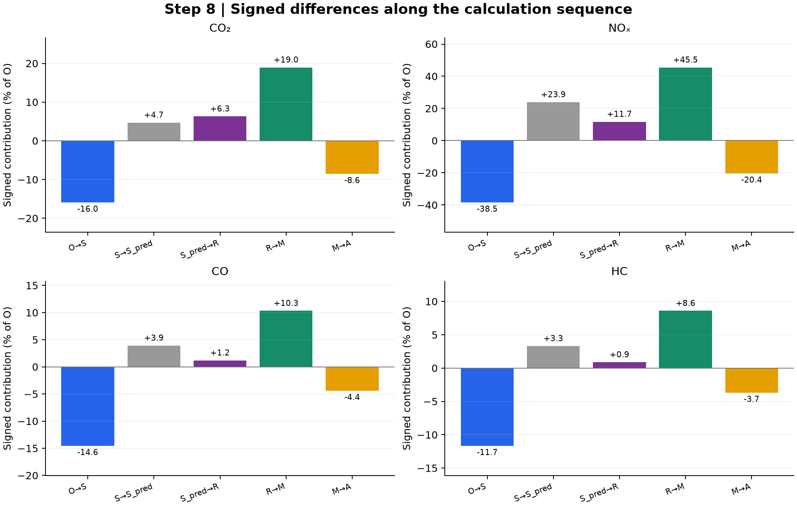

# 8. Sum results and account for method differences

| Result | What it contains |
| --- | --- |
| [Method totals](method_totals.csv) | All 20 totals, O comparison, signed and absolute differences. |
| [Signed components](signed_error_components.csv) | Each successive change, with before/after totals and percentage of O. |
| [Fitted-mean split](fitted_mean_symmetric_split.csv) | Separate vehicle-hours and induced mean-speed/rate contributions. |
| [Published-total reconciliation](published_total_reconciliation.csv) | Recalculated versus current published totals, with residuals. |
| [VSP comparison](vsp_comparison.csv) | Operating-time mean/standard deviation, plus aligned-bin bias, MAE and RMSE relative to the O proxy. |

For this one worked example:

$$\mathrm{signed\ error}_{m,p}=100\frac{E_{m,p}-E_{O,p}}{E_{O,p}},\qquad
\mathrm{WAPE}_{m,p}=100\frac{|E_{m,p}-E_{O,p}|}{E_{O,p}}.$$

The absolute percentage is the **one-case** WAPE; it is not the 137-episode pooled statistic. In the paper comparison, absolute episode differences are summed before division by the sum of O episode totals.

Define the diagnostic intermediate $E_{S,pred}=H_Pr_p(DL/H_P)$. The ordered accounting chain is:

$$O\ \to\ S\ \to\ S_{pred}\ \to\ R\ \to\ M\ \to\ A.$$

Its successive differences measure observed mean-rate aggregation, fitted mean delay/speed, reconstructed trip-speed variation, two operating-speed allocation and cubic-rate replacement. Their signed sum reproduces the corresponding total discrepancy. They are order-dependent mathematical accounting, not independent causal effects; absolute errors do not add.

For the second transition, let $r_O=r_p(DL/H_O)$ and $r_P=r_p(DL/H_P)$:

$$\Delta E_H=(H_P-H_O)(r_P+r_O)/2,\qquad
\Delta E_r=(r_P-r_O)(H_P+H_O)/2.$$

These sum exactly to $E_{S,pred}-E_S$. They expose why a lower fitted vehicle-hours value can still increase emissions when the implied mean speed crosses a lookup boundary.

**Figures:** the signed-component table supplies the final report page. **Verification:** all 20 totals and 1,140 common-clock values reproduce the existing report calculations within floating-point precision; see [verification](../verification.json).

For VSP closeness, $\Delta Z_{i,m}=Z_{i,m}-Z_{i,O}$. The reported bias and MAE are $\sum_iH_{i,O}\Delta Z_{i,m}/H_O$ and $\sum_iH_{i,O}|\Delta Z_{i,m}|/H_O$; RMSE is the square root of the similarly weighted squared difference. **All methods use O vehicle-hours for these paired comparisons.** Each method's own operating-time weights are used for its episode VSP mean and standard deviation. These are descriptive comparisons to the detector-speed proxy, not validation against measured vehicle VSP.

The figure shows signed emission contributions; positive and negative effects can cancel. [Editable SVG](diagnostic.svg).

[All steps](../README.md)
